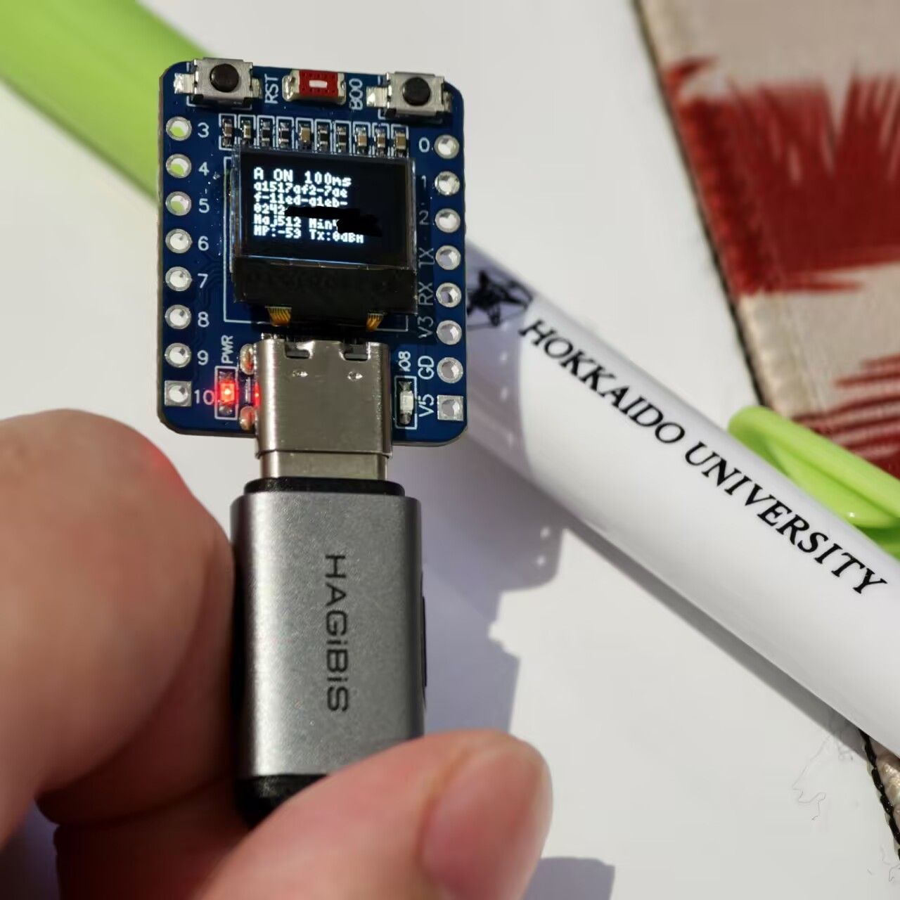

# ESP32 iBeacon Lab

**English** | [简体中文](README.zh-CN.md)

A configurable iBeacon broadcaster for the ESP32-C3 Super Mini with a 72×40 OLED display.

Designed for BLE experiments, receiver testing, and learning how iBeacon advertising works.



## Features

- Alternates between two configurable iBeacon profiles.
- Displays the current profile, UUID, Major, Minor, and power settings.
- Toggles advertising with the onboard BOOT button.
- Supports serial commands for control and diagnostics.
- Runs without an open serial monitor.
- Reports configuration errors and BLE initialization timeouts.

Both profiles share one BLE address and alternate every two seconds
by default. The default advertising interval is 100 ms.

## Hardware

Target board: ESP32-C3 Super Mini with a built-in 72×40 OLED.

| Component | Default configuration |
|-----------|-----------------------|
| OLED | SSD1306, 72×40 |
| OLED SDA | GPIO5 |
| OLED SCL | GPIO6 |
| OLED I²C address | Automatically detects 0x3C or 0x3D |
| BOOT button | GPIO9, active low |

Pin assignments can be changed in `BeaconConfig.h`.
Check the wiring for your particular board.

## Getting started

Known working software versions:

- Arduino-ESP32: 3.3.12
- U8g2: 2.36.19

The BLE library is included in the ESP32 board package.
This sketch targets its NimBLE backend.

1. Install the ESP32 board package and U8g2 library in Arduino IDE.
2. Open `BeaconLabC3/BeaconLabC3.ino`.
   Keep `BeaconConfig.h` in the same sketch directory.
3. Select:
   - Board: **ESP32C3 Dev Module**
   - USB CDC On Boot: **Enabled**
   - Flash Mode: **DIO**
4. Select the board's port, compile, and upload.

Advertising starts automatically after initialization.
Use a BLE scanner on another device to inspect the broadcasts.
Enable repeated updates to observe both alternating profiles.

## Controls

| Input | Action |
|-------|--------|
| Short press BOOT | Stop or resume advertising |
| Serial `s` | Stop |
| Serial `r` | Resume |
| Serial `i` | Show current state and configuration |

Serial baud rate: **115200**.

Press BOOT after startup. Holding it during reset may enter
the board's download mode.

## Configuration

Edit the settings in `BeaconConfig.h`, then recompile and upload.
The following independent test identities are examples;
the firmware broadcasts the values currently set in the configuration module.

```cpp
constexpr int TX_POWER_DBM = 0;
constexpr uint32_t ADV_INTERVAL_MS = 100;
constexpr uint32_t DWELL_MS = 2000;

constexpr Profile PROFILES[2] = {
  {"59275ba7-ef3d-41b2-84d4-f3b34e493c5b", 101, 1, -59},
  {"5f904a31-48db-4270-8dda-9b9b3df2c585", 202, 2, -59}
};
```

Each profile contains:

1. UUID
2. Major
3. Minor
4. Measured Power

`TX_POWER_DBM` requests the radio transmit power.
Measured Power is the advertised RSSI calibration value at one metre.
The example value of −59 has not been calibrated for this board.

Configuration is compiled into the firmware.
No configuration file is read at startup.

## Display and diagnostics

The OLED shows:

- Current profile and ON/OFF state
- Complete UUID
- Major and Minor
- Measured Power (`MP`)
- Requested transmit power (`Tx`)

Startup progresses through `CFG LOAD`, `CFG OK`, `BLE WAIT`,
`AD SETUP`, and `ON`.
A BLE initialization timeout displays `BLE TIMEOUT`.
Open the serial monitor and send `i` to inspect the error.

## Verification

The 2026-10-08 firmware build succeeded with the versions listed above.
Over-the-air reception has been confirmed using a phone by the project author.

The BOOT button, complete OLED rendering, cold starts, transmit power
accuracy, and distance calibration have not been independently checked
as separate hardware tests.
